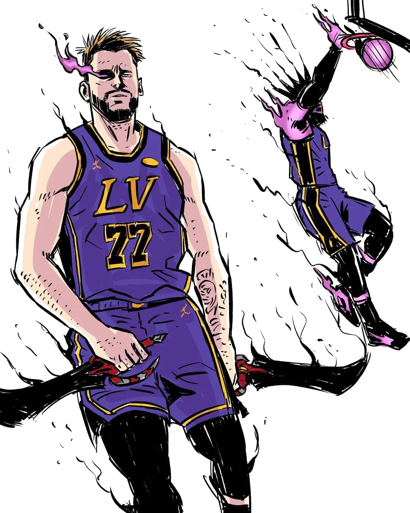

<!-- Banner -->

  

<table>
  <tr>
    <td width="42%" valign="top">
      
    </td>
    <td width="58%" valign="top">

<h1>// About me</h1>

Hi, I'm **Marco F. Silva** — a software engineering student from **Torreón, Coahuila 🇲🇽**.

I enjoy building things from start to finish—the screen users interact with and the magic behind how the software works—and I’d like to know how it all works in the world of game development.

Lately I've been spending my weekends at hackathons, where I've worked on **detecting synthetic voices in bank phone calls** and building the **backend of a smart retail store**. In class I've written a **C compiler** from scratch, Android apps with **Jetpack Compose**, and a **network simulator** that runs in the browser.

Right now I'm deep into **APIs using .NET**

   </td>
   </tr>
   </table>
   
   <table>
   <tr>
   <td width="60%" valign="top">
   
   <h1>// Skills</h1>
   
   <h2>languages</h2>
   
   
   
   
   
   
   
   
   
   
   
   <h2>other skills</h2>
   
  
   
   
   
   
   
   
   
   
   
   
   
   
   
   <h2>currently learning</h2>
    
   
   
   
   
   
   
   <h2>spoken languages</h2>
   
   
   
   
   </td>
   <td width="40%" valign="top">
   
   </td>
   </tr>
   </table>
   
   <h1>// Projects</h1>
   
   <table>
   <tr>
   <td width="50%" valign="top">
   
   ### 🎙️ [altur-hack](https://github.com/Tyreans/altur-hack)
   **HackMTY 2026 · Altur challenge**
   A system that detects synthetic (AI-generated) voices in bank phone calls. I built the **fast check**: rule-based signals on turn-taking and interruptions that filter calls before the heavier acoustic model runs.
   
   `Python` `FastAPI` `librosa` `scikit-learn`
   
   </td>
   <td width="50%" valign="top">
   
   ### 🛒 [Smart Retail Store](https://github.com/Tyreans/HACK_SALTILLO_RETO_SOFTEK)
   **Hack Saltillo Road to Tech 2026 · Softtek challenge**
   An intelligent store platform for retail. I worked on the **Express.js API**, the **PostgreSQL** database and exporting inventory tables to Excel.
   
   `Node.js` `Express` `PostgreSQL` `Gemini API`
   
   </td>
   </tr>
   <tr>
   <td width="50%" valign="top">
   
   ### ⚙️ [Flex_Cup_Compiler](https://github.com/MarKoXLanda/Flex_Cup_Compiler)
   A compiler for C code built with **JFlex and CUP**. It does lexical analysis and produces a token table, three-address code and Polish notation.
   
   `Java` `JFlex` `CUP`
   
   </td>
   <td width="50%" valign="top">
   
   ### 🌐 [App_NetSimulator](https://github.com/MarKoXLanda/App_NetSimulator)
   A browser app that simulates a network: its devices, how much bandwidth each one uses, and a graph of how they talk to each other.
   
   `HTML` `JavaScript` `CSS`
   
   </td>
   </tr>
   <tr>
   <td width="50%" valign="top">
   
   ### 🎬 [cineApp](https://github.com/MarKoXLanda/cineApp)
   An Android app that shows a catalog of movies with their descriptions, built with **Jetpack Compose** layouts.
   
   `Kotlin` `Jetpack Compose`
   
   </td>
   <td width="50%" valign="top">
   
   ### 🏥 [ClinicaApi](https://github.com/MarKoXLanda/ClinicaApi)
   A clinic management API, used as the base for a database architecture project with **IBM Db2** and high availability (HADR).
   
   `Db2` `SQL` `🚧 in progress`
   
   </td>
   </tr>
   </table>
   
   <h1>// Stats</h1>
   
   

   
   
   

   
   <h1>// Contact</h1>
   
   
   
   